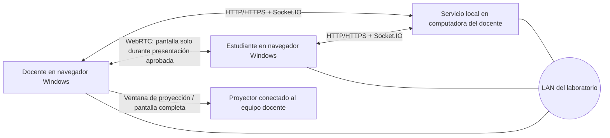
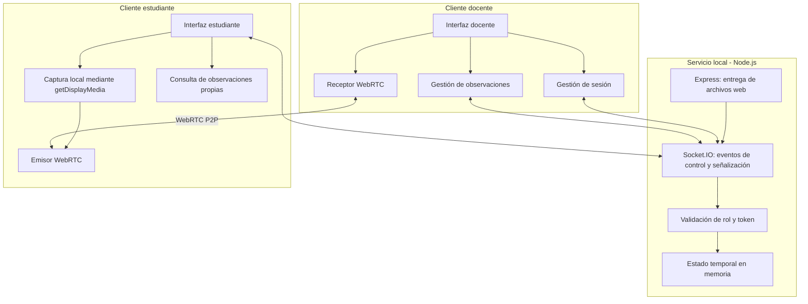
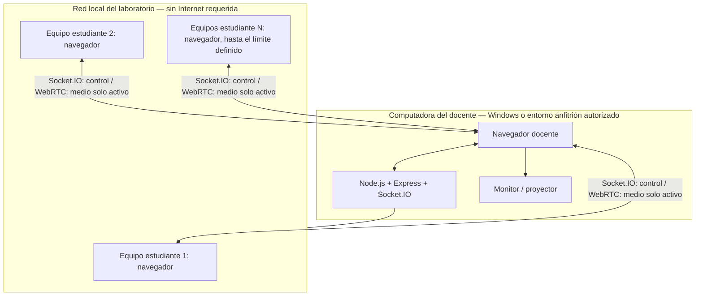
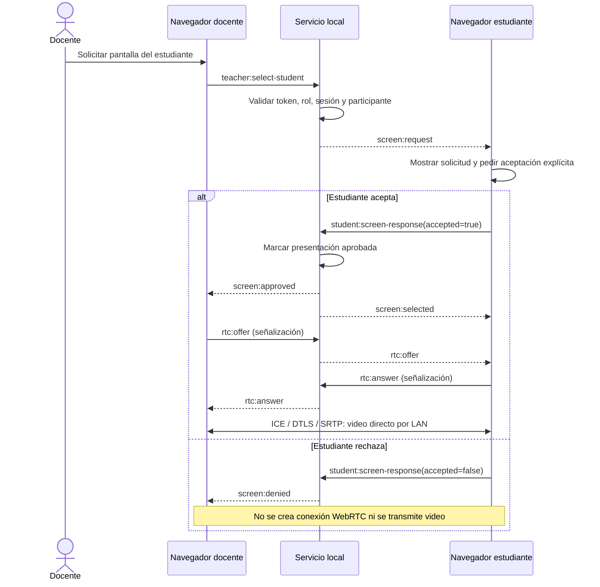
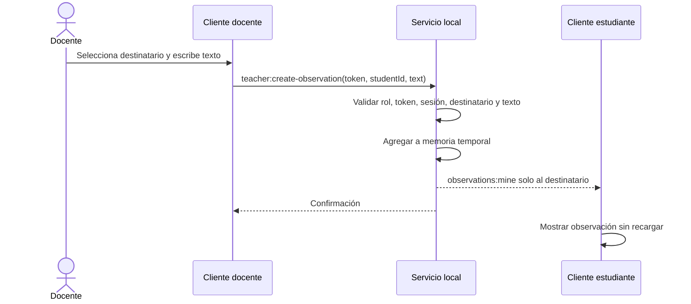
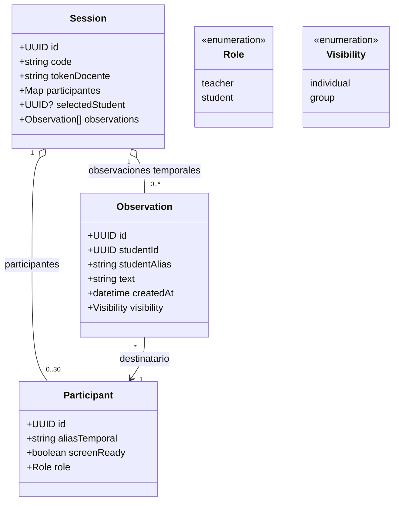
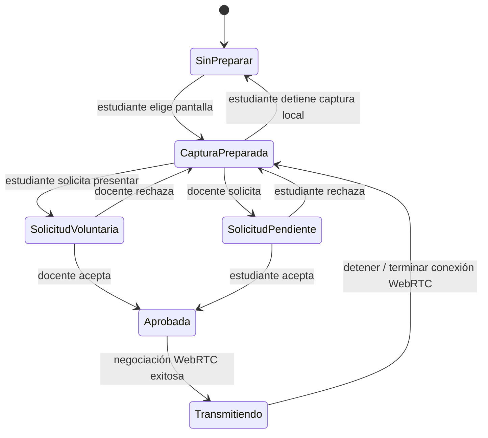

# Diseño arquitectónico — Sistema local de retroalimentación

**Versión:** 0.1  
**Estado:** arquitectura inicial para revisión; las decisiones marcadas como propuestas requieren validación mediante pruebas y contra el SRS.  
**Restricciones confirmadas:** aplicación web local; operación mediante LAN sin Internet; equipos cliente Windows; servicio alojado en la computadora del docente; datos temporales sin persistencia; visualización de pantalla en tiempo real bajo solicitud/aceptación.

## 1. Objetivo y principios

La arquitectura separa la gestión de sesión y permisos del transporte multimedia. El servidor local administra participantes, autorización, solicitudes de presentación y observaciones. La pantalla se transmite directamente entre el navegador del estudiante y el navegador del docente mediante WebRTC cuando existe una presentación aprobada. El servidor no recibe ni retransmite el video.

Principios:

1. **Sin transmisión por defecto:** la captura local no implica envío de video por la red.
2. **Consentimiento explícito:** una solicitud del docente no inicia transmisión hasta que el estudiante acepta. El estudiante también puede solicitar presentar voluntariamente; el docente autoriza la presentación.
3. **Separación de planos:** Socket.IO transporta eventos de control y señalización; WebRTC transporta el medio entre pares.
4. **Minimización de red:** solo se establece una conexión de medios para el estudiante cuya presentación fue aprobada.
5. **No persistencia:** sesión, participantes y observaciones viven en memoria y se eliminan al finalizar o reiniciar el servicio.
6. **Autorización en servidor:** los eventos sensibles validan rol, sesión, token y pertenencia del participante; la interfaz no es una frontera de seguridad.
7. **LAN sin dependencia externa:** no se requiere un servicio en la nube. La conexión P2P se prueba con la topología y las políticas de firewall reales del laboratorio.

## 2. Vista de contexto

El diagrama muestra que el medio WebRTC viaja de navegador a navegador; el servidor local coordina permisos y señalización, no actúa como servidor de video.

## 3. Vista lógica / componentes

## 4. Vista de despliegue

**Nota de despliegue:** para compartir pantalla, los navegadores exigen un contexto seguro. `localhost` es válido para pruebas locales; el acceso desde otras computadoras requiere resolver HTTPS con un certificado confiable para los clientes. La viabilidad de WebRTC en la LAN y la configuración del firewall deben verificarse en el entorno real. No se debe afirmar compatibilidad total antes de esa prueba.

## 5. Flujo de presentación de pantalla

### 5.1 Preparación

El estudiante pulsa explícitamente **Autorizar y elegir pantalla**. El navegador muestra su selector de pantalla/ventana. Si acepta, se obtiene un `MediaStream` local. No se envía video al servidor y no se crea una conexión WebRTC de medios en esta fase. La captura sí consume recursos locales mientras está preparada; por tanto, la interfaz permite detenerla.

### 5.2 Presentación solicitada por el docente

### 5.3 Presentación voluntaria

El estudiante pulsa **Solicitar presentar mi pantalla**. El servidor notifica al docente; el docente acepta o rechaza. Solo tras la aprobación se inicia la negociación WebRTC.

### 5.4 Detener la transmisión

Al detener la revisión se cierra el `RTCPeerConnection` de ambos extremos. La sesión Socket.IO y la sesión de clase continúan activas. Esto garantiza que WebRTC no siga enviando video ni mantenga tráfico de control de esa conexión. La captura local puede permanecer preparada sin transmitir; el estudiante puede detenerla explícitamente. Si se requiere literalmente cero tráfico WebRTC, cerrar la conexión es la opción correcta: mantener un `RTCPeerConnection` abierto puede generar paquetes de mantenimiento/consentimiento aunque no haya video.

## 6. Flujo de observación individual

## 7. Modelo de dominio / datos temporales

La visibilidad `group` queda modelada como posibilidad futura, pero el incremento implementado solo permite `individual`. Compartir con el grupo debe ser una acción explícita del docente en un incremento posterior.

## 8. Estados de la presentación

## 9. Decisiones arquitectónicas

| ID | Decisión | Estado | Motivo |
|---|---|---|---|
| ADR-01 | Aplicación web local | Confirmada | Acceso desde los equipos del laboratorio sin instalar cliente de escritorio |
| ADR-02 | Servicio en computadora del docente | Confirmada | Reduce dependencias de infraestructura externa |
| ADR-03 | Estado en memoria sin persistencia | Confirmada | Se elimina la información al finalizar la sesión |
| ADR-04 | Socket.IO para control y señalización | Propuesta técnica | Facilita eventos en tiempo real dentro de la LAN |
| ADR-05 | WebRTC P2P para pantalla | Propuesta técnica | Evita que el servidor retransmita cada fotograma a todos los equipos |
| ADR-06 | Solo un estudiante transmitiendo al docente a la vez | Propuesta para MVP | Limita consumo de ancho de banda y complejidad; validar contra el SRS |
| ADR-07 | Cerrar RTCPeerConnection al detener revisión | Decisión de diseño para cumplir cero tráfico WebRTC | Mantiene Socket.IO de la sesión y evita tráfico multimedia/de control WebRTC posterior |
| ADR-08 | Observaciones individuales en memoria | Propuesta implementada inicialmente | Evita persistencia y exposición al grupo |
| ADR-09 | HTTPS con certificado confiable para acceso LAN | Requisito técnico pendiente | La captura de pantalla requiere contexto seguro en navegadores modernos |

## 10. Seguridad y privacidad

- El token del docente debe permanecer solo en el cliente docente y enviarse en eventos de operación protegidos.
- El servidor valida rol, sesión y destinatario para cada evento sensible.
- El contenido multimedia se negocia únicamente para la presentación aprobada.
- No se debe enviar la pantalla a un servidor central ni a otros estudiantes.
- Los textos de observación se entregan solo al destinatario mientras la observación sea individual.
- No registrar en logs el contenido de pantallas ni de observaciones.
- Al finalizar sesión, borrar estado temporal y cerrar conexiones WebRTC activas.
- Probar explícitamente rechazo de solicitudes, desconexión, finalización de sesión y cambio de estudiante.

## 11. Riesgos y validaciones pendientes

1. **Captura de pantalla y permisos:** el navegador requiere una acción del usuario para iniciar la captura; no puede tratarse como un permiso persistente silencioso.
2. **Contexto seguro:** configurar HTTPS confiable para los equipos clientes de la LAN.
3. **Conectividad WebRTC:** validar negociación directa entre subredes/VLAN reales y reglas de firewall. El prototipo no configura servidores STUN/TURN; si la red impide conectividad directa, se deberá decidir una solución LAN compatible.
4. **Rendimiento:** medir uso de red con una transmisión activa y con cero transmisiones; no declarar que la red no se satura sin mediciones.
5. **Observaciones:** verificar privacidad entre estudiantes y no persistencia después de finalizar la sesión.
6. **Límite de participantes:** probar con la carga prevista de hasta 30 participantes, aunque solo se comparta una pantalla a la vez.

## 12. Diagramas recomendados para documentación completa

Mínimo para el paquete de arquitectura:

- Diagrama de contexto (actores, sistema y entorno).
- Diagrama de componentes (responsabilidades y protocolos).
- Diagrama de despliegue (equipos, procesos y LAN).
- Diagrama de secuencia de captura, solicitud, aprobación, transmisión y detención.
- Diagrama de secuencia de creación y consulta de observaciones.
- Diagrama de clases/modelo temporal de datos.
- Diagrama de estados de sesión y presentación.
- Matriz de trazabilidad requisito → componente → caso de prueba.

Este documento contiene los diagramas principales. La matriz de trazabilidad debe completarse contra los IDs exactos del SRS y backlog antes de declarar el diseño final.

## 13. Matriz inicial de trazabilidad

Esta matriz vincula los requisitos del SRS que se relacionan directamente con los cambios de este incremento. Debe ampliarse con los casos de uso y números de prueba completos de la versión de SRS usada en la entrega académica.

| Requisito | Componente responsable | Modelo / flujo | Prueba propuesta |
|---|---|---|---|
| RF-005 — seleccionar estudiante | Cliente docente + servicio de sesión | Secuencia de solicitud de pantalla | CP-SCR-01: solicitar a participante activo |
| RF-006 — visualizar trabajo | Captura local + emisor/receptor WebRTC | Secuencia de presentación | CP-SCR-02: transmisión solo tras aceptación |
| RF-007 — registrar observación | Módulo de observaciones + servicio local | Secuencia de observación | CP-OBS-01 y CP-OBS-03 |
| RF-008 — consultar observación propia | Cliente estudiante + filtro por `studentId` | Secuencia de observación | CP-OBS-02 y CP-OBS-04 |
| RF-012 — finalizar sesión | Servicio de sesión | Modelo `Session` | CP-OBS-06 / CP-NP-001 |
| RNF-001 — operación sin Internet | Servicio local, Socket.IO y WebRTC en LAN | Despliegue | CP-LAN-01: deshabilitar Internet manteniendo LAN |
| RNF-002 — no persistencia | Estado en memoria y cierre de sesión | Modelo temporal | CP-NP-001 |
| RNF-003 — rendimiento | Transporte de observaciones / medio P2P | Secuencias | CP-PERF-01: medir entrega de observación y tasa de red de pantalla |
| RNF-006 — roles y permisos | Validadores del servidor | Componentes de autorización | CP-ROL-01/02: denegar eventos fuera de rol |
| RNF-007 — compatibilidad | Navegadores cliente | Despliegue | CP-COMP-01: navegador/Windows del laboratorio |
| RNF-008 — comunicación local | Express, Socket.IO y WebRTC | Despliegue | CP-LAN-02: verificar tráfico exclusivamente LAN |

Los nombres descriptivos de los requisitos son resumidos. Para una entrega formal, conserva los textos normativos exactos del SRS y añade evidencia de ejecución a cada prueba.
