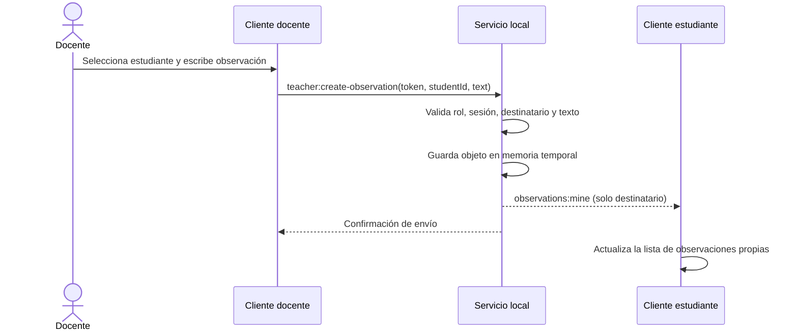

# Diseño funcional: gestión de observaciones individuales

**Proyecto:** Sistema local de retroalimentación para laboratorios de cómputo  
**Versión:** 0.1 — propuesta implementada en el incremento de desarrollo  
**Estado:** diseño inicial; validar con pruebas funcionales y contra el SRS completo antes de declarar conformidad.

## 1. Propósito

Permitir que el docente escriba una observación concreta para un estudiante, que este la consulte desde su panel mientras la sesión siga activa. La información se mantiene en memoria del servidor y se elimina al finalizar la sesión o reiniciar el proceso. No se guarda historial permanente.

## 2. Alcance de esta primera versión

Incluye:

- Seleccionar al estudiante destinatario entre los participantes activos.
- Escribir una observación de texto de hasta 1,000 caracteres.
- Enviar la observación únicamente al destinatario.
- Mostrar las observaciones del estudiante en su panel.
- Mantener los datos en memoria durante la sesión.
- Eliminar observaciones al finalizar la sesión.

No incluye todavía:

- Compartir observaciones con todo el grupo.
- Proyectar observaciones.
- Editar o borrar observaciones individuales.
- Adjuntar imágenes o archivos.
- Persistir historial tras cerrar la sesión.
- Confirmación de lectura o evaluación de la calidad de la observación.

Estas exclusiones no eliminan los requisitos correspondientes del SRS; se reservan para incrementos posteriores según el backlog.

## 3. Reglas de negocio propuestas

1. Solo el docente autenticado para la sesión activa puede crear observaciones.
2. El destinatario debe pertenecer a la sesión activa.
3. El texto no puede estar vacío y se limita a 1,000 caracteres.
4. Cada observación tiene identificador temporal, ID del destinatario, alias al momento de creación, texto, fecha/hora y visibilidad.
5. La visibilidad inicial siempre es `individual`.
6. Una observación individual nunca se difunde a otros estudiantes ni se proyecta automáticamente.
7. El estudiante solo puede consultar observaciones cuyo `studentId` coincida con su identidad temporal.
8. Al cerrar la sesión, el servidor elimina las observaciones junto con los demás datos temporales.
9. Las observaciones no se registran en archivos de log. Los logs técnicos no deben incluir el contenido de los textos.

## 4. Modelo de datos temporal

| Campo | Tipo lógico | Descripción |
|---|---|---|
| `id` | UUID | Identificador de la observación |
| `studentId` | UUID | Identificador temporal del destinatario |
| `studentAlias` | Texto | Alias para facilitar la inspección durante la sesión |
| `text` | Texto, máximo 1,000 caracteres | Contenido de la observación |
| `createdAt` | Fecha/hora ISO 8601 | Momento de creación |
| `visibility` | Enumeración | En esta etapa: `individual` |

La estructura se almacena en `session.observations` en memoria. No se utiliza una base de datos.

## 5. Flujo principal

## 6. Flujos alternativos y errores

- **Sin destinatario:** el cliente solicita seleccionar un estudiante y no envía el evento.
- **Texto vacío:** el servidor rechaza la solicitud.
- **Texto demasiado largo:** el cliente limita a 1,000 caracteres y el servidor recorta defensivamente.
- **Estudiante desconectado:** el servidor rechaza el envío porque ya no pertenece a la sesión activa.
- **Token de docente inválido:** el servidor rechaza la operación.
- **Sesión finalizada:** no se aceptan nuevas observaciones; el estado temporal se elimina.

## 7. Criterios de aceptación

- CA-OBS-01: el docente puede seleccionar un participante activo y enviar texto no vacío.
- CA-OBS-02: el destinatario ve la observación sin recargar la página.
- CA-OBS-03: un segundo estudiante no recibe la observación individual.
- CA-OBS-04: un cliente con rol estudiante no puede crear observaciones en nombre del docente.
- CA-OBS-05: no se acepta una observación para un participante que ya no está en la sesión.
- CA-OBS-06: al finalizar la sesión e iniciar otra, no aparecen observaciones de la sesión anterior.
- CA-OBS-07: el flujo funciona sin acceso a Internet, manteniendo la LAN activa.
- CA-OBS-08: se mide el tiempo de entrega; el objetivo de rendimiento aplicable del SRS debe comprobarse mediante pruebas, no suponerse cumplido.

## 8. Casos de prueba iniciales

| ID | Preparación / acción | Resultado esperado |
|---|---|---|
| CP-OBS-01 | Docente envía observación válida a estudiante A | A la ve en su panel |
| CP-OBS-02 | A y B conectados; docente envía observación a A | B no recibe el contenido |
| CP-OBS-03 | Docente envía texto vacío | Se rechaza y no se crea registro |
| CP-OBS-04 | Cliente estudiante intenta emitir evento de creación | Servidor rechaza por rol/token |
| CP-OBS-05 | Destinatario sale antes del envío | Servidor rechaza destinatario inexistente |
| CP-OBS-06 | Se finaliza sesión y se crea otra | No hay observaciones anteriores |
| CP-OBS-07 | Internet deshabilitado, LAN activa | La observación se entrega dentro de la LAN |
| CP-OBS-08 | Se envía una observación y se mide latencia | Se registra tiempo observado y se compara con RNF-003 |

## 9. Decisiones que requieren validación

- **Propuesta:** las observaciones individuales son de solo lectura durante la sesión.
- **Propuesta:** no se añade confirmación de lectura en este incremento.
- **Propuesta:** el alias se conserva como dato descriptivo, pero la autorización se basa en el ID temporal y el rol, no en el alias.
- **Confirmado por el alcance existente:** los datos son temporales y no se conserva historial después de cerrar la sesión.
- **Confirmado por el alcance existente:** compartir observaciones con el grupo y proyectarlas son capacidades distintas y no deben activarse automáticamente al crear una observación individual.
