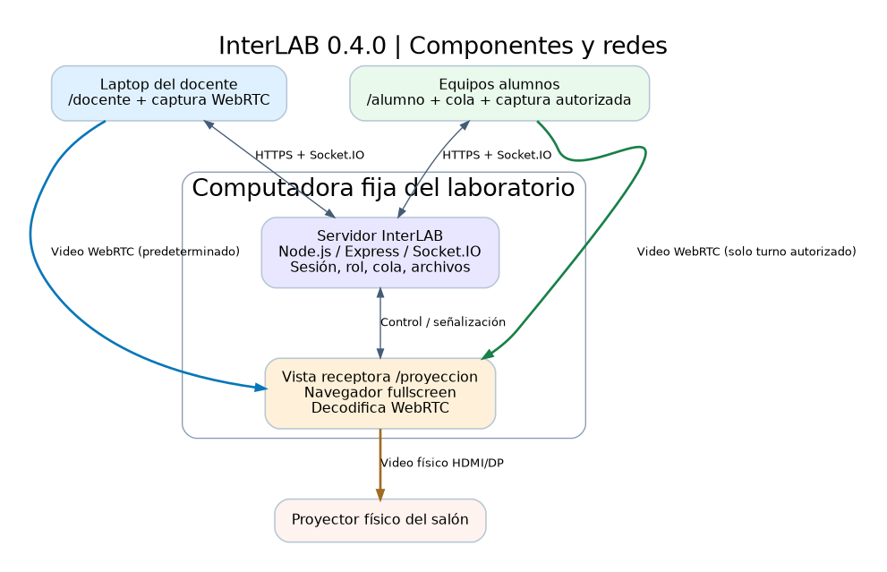
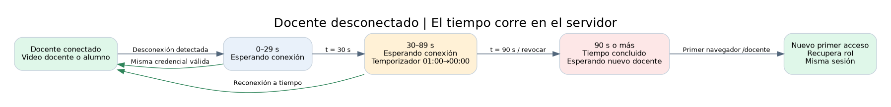
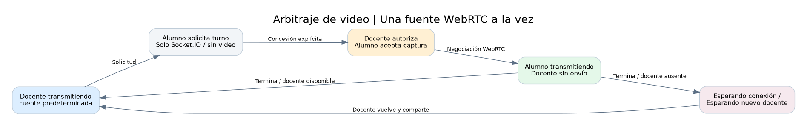

# InterLAB — Arquitectura objetivo de servidor independiente y receptor WebRTC

**Documento:** ARQ-OBJ-040 · **Fecha:** 28-10-2026  
**Estado:** modelo objetivo para futura implementación; **no corresponde al código actual**.  
**Fuente:** decisiones del rediseño, SRS original y alcance v1.2. **Base del código que se transformará:** InterLAB 0.4.0 beta (procedente de PIIS 0.3.4).

## 1. Arquitectura de alto nivel

La **computadora fija** contiene (a) proceso Node.js/Express/Socket.IO; (b) catálogo y archivos temporales de sesión; (c) navegador en modo receptora `/proyeccion` conectado al proyector físico. Son componentes conceptualmente independientes: detener el navegador receptor no destruye el proceso ni el estado de sesión.

La **laptop docente** contiene la vista `/docente` y la captura WebRTC de su pantalla iniciada por gesto. Los **equipos alumnos** contienen `/alumno`, solicitan turnos sin video, y crean/negocian WebRTC solo al aceptar el turno autorizado. **El proceso Node.js señaliza y arbitra**; es el navegador receptor el que decodifica/visualiza el video WebRTC. No se propone introducir un servidor de medios, SFU ni grabación para esta versión; habría que reevaluarlo si se necesitan múltiples receptores.

| Canal | Medio | Emisor → receptor | Propósito |
|---|---|---|---|
| Control HTTP | HTTPS/Express | Docente/alumno/receptor ↔ servidor | Vistas, archivos, operaciones autenticadas |
| Eventos | Socket.IO sobre canal seguro | Navegadores ↔ servidor | Rol, sesión, cola, permisos, cronómetro y señalización |
| Video | WebRTC | Docente **o** alumno autorizado → navegador `/proyeccion` | Solo una pantalla activa; flujo P2P en LAN cuando sea viable |
| Salida | HDMI/DP/VGA según equipo | Computadora fija → proyector | Visualización física de la pantalla receptora |

## 2. Estado separado por responsabilidad

| Dominio | Estados orientativos | Regla |
|---|---|---|
| Servicio | Arrancando, listo, detenido | Solo reinicio del proceso destruye y limpia sesión previa |
| Sesión de clase | No existe, activa, cerrando, finalizada | Solo cierre explícito o reinicio la finaliza |
| Titular docente | Libre, conectado, en reconexión, expirado/libre | Desconexión inicia plazo de 90 s sin finalizar sesión |
| Presentación | Espera, docente, estudiante(id), transición | Solo una fuente válida; receptor siempre conoce el turno actual |
| Cola | Solicitud pendiente, otorgada, rechazada, retirada | Se conserva sin docente; solicitud desconectada se elimina |
| Receptor | Iniciando, conectado, interrumpido, recuperando | Pérdida de receptor no extingue sesión |

Es recomendable representar estos estados con **máquinas separadas y una generación de turno** (`presentationEpoch` o equivalente). Toda oferta ICE/SDP, señalización y permiso de transmisión deberá comprobar la generación vigente para descartar mensajes tardíos de una transmisión previa. Es una **propuesta técnica** para resolver la incidencia A→B, no garantía de corrección.

## 3. Identidad y autoridad

- **Código visible:** dato temporal de cuatro dígitos según el código actual; los alumnos lo usan para incorporarse. Mantener formato o reforzarlo es una decisión de seguridad todavía por revisar; no usar el código como credencial docente.
- **Credencial privada docente:** identificador aleatorio de alta entropía en cookie `HttpOnly`, `Secure`, `SameSite` y alcance apropiado. El servidor debe validar posesión, versión/generación y vencimiento antes de cualquier operación administrativa. Cookie como diseño propuesto, no tecnología aprobada por el usuario.
- **Primer acceso:** el primero que solicita `/docente` **cuando el rol está libre** se apropia del rol; no basta con que se cargue HTML si se necesita bloquear carreras. El servidor asigna de forma atómica. **Riesgo:** un alumno puede tomar el rol primero; está confirmado como política del producto.
- **Receptor fijo:** solo la instancia autorizada del equipo fijo debería poder recibir señalización/video. No confiar en conocer `/proyeccion`: autenticar identidad de receptor mediante mecanismo local específico (por diseñar). No se autoriza a cualquier navegador de la LAN a ver la pantalla.
- **Alumno:** alias no autentica operaciones; la sesión y las acciones de archivos usan un identificador interno o token por ingreso. La desconexión libera sus turnos/cola según reglas confirmadas.
- **Recuperación manual:** comando/control estrictamente local y para uso del profesor, como excepcional. No habilitar endpoint remoto desprotegido.

## 4. Tiempos de recuperación docente

Al confirmar una desconexión docente, el servidor anota `disconnectedAt` y `expiresAt = disconnectedAt + 90s` (conceptual). El plazo **no depende de una pestaña abierta ni se reinicia por cada solicitud**.

- 0 ≤ t < 30 s: cuando no hay video activo, receptor muestra «Esperando conexión».
- 30 ≤ t < 90 s: añade cuenta regresiva del último minuto, derivada del instante de expiración definido por el servidor.
- t ≥ 90 s: se revoca la credencial, el control pasa a libre y cuando no hay video activo muestra «Tiempo de espera concluido, esperando nuevo docente».
- Reconexión de mismo perfil/credencial antes de 90 s: se cancela vencimiento, recupera administración; la nueva captura exige nueva acción si el `MediaStream` se perdió.
- Si alumno autorizado continúa presentando durante el plazo o después: no se superpone aviso/contador sobre su video; el plazo sigue corriendo internamente. Al parar, se muestra el estado que corresponda a ese instante.

**No usar el estado del receptor como detector primario de presencia del docente.** Receptor, flujo WebRTC, presencia Socket.IO y pertenencia administrativa son dimensiones diferentes.

## 5. Gestión de presentación y exclusividad

### 5.1 Predeterminada docente

El docente pulsa «Compartir pantalla» para solicitar `getDisplayMedia()`. Si hay sesión y turno del docente, el navegador negocia WebRTC con la vista receptora. La primera conexión al rol puede preparar el canal de control antes de crear sesión, pero **la política de cuándo se permite video antes de crear sesión aún requiere validación**; no inventar ese detalle al programar.

### 5.2 Solicitud del alumno

1. Alumno envía solicitud por Socket.IO sin `getDisplayMedia()` ni `RTCPeerConnection` activo.
2. Servidor agrega a cola ordenada. Si no hay docente, no otorga. Puede retirar solicitud el estudiante.
3. Docente aprueba desde la cola o selecciona directamente; el servidor envía aviso al alumno.
4. Alumno acepta y ejecuta acción de captura permitida por navegador.
5. Servidor confirma autorización temporal, revoca/cierra **la transmisión WebRTC docente** y habilita la del alumno hacia el receptor fijo; conserva la preferencia docente para el retorno.
6. Alumno termina, docente detiene o se detecta desconexión alumno: se revoca inmediatamente turno, se cierra su peer y se restablece flujo docente **si está disponible**, o se muestra espera.

**Punto técnico por precisar:** orden exacto entre aceptar captura de alumno, apagar video docente y generar nueva negociación; debe evitar pantalla negra prolongada, superposición y fuga de video no autorizado. No se autoriza por mera cola. Las credenciales efímeras de negociación deben estar asociadas al `presentationEpoch` actual.

### 5.3 Continuidad sin docente

Mientras el docente está desconectado o expiró, alumno ya autorizado continúa presentando; otras solicitudes entran a la cola. Nuevas concesiones bloqueadas hasta que exista docente válido. Archivos y admisión siguen funcionando; no suspender sesión.

## 6. Almacenamiento y ciclo de sesión

La sesión permanece en RAM del proceso mientras ese proceso siga vivo. El catálogo de archivos en RAM y binarios temporales en disco permanecen durante una desconexión/expiración administrativa. El ciclo del módulo de archivos `src/file-store.js` mantiene sus reglas existentes de cuotas 50 MB/archivo, 200 MB/selección, 10 GB/sesión, concurrencia 2 y streaming, sujeto a pruebas de integración y prioridades WebRTC.

**Reinicio:** el proceso no restaura sesión/cola/tokens desde disco. Para cumplir limpieza tras corte imprevisto, el arranque debe localizar y borrar **solo** el directorio propio de sesiones temporales, de manera controlada y antes de aceptar conexiones. Nunca borrar directorios arbitrarios. Una falla de limpieza debe bloquear el arranque operativo o señalar un error explícito, no dar por satisfecho el requisito.

**Cierre explícito:** operación exclusiva del docente válido; revoca permisos, corta todas las transferencias y PeerConnections y elimina temporales sin permitir publicación tardía.

## 7. Despliegue previsto (por concretar)

- Servidor Node.js con autoarranque del sistema operativo, reinicio supervisado solo si se desea, políticas de apagado y registros. No confundir arranque automático del servicio con «persistencia de sesión» entre reinicios.
- Sesión gráfica de la computadora fija habilitada para abrir `/proyeccion` automáticamente en fullscreen/kiosco. Si no hay interfaz gráfica, el servicio puede iniciar pero el receptor no se visualizará; se requiere diagnóstico.
- HTTPS válido/fiable en equipo fijo, laptop docente y estaciones de alumnos para permisos de captura. Validar confianza del certificado antes de comenzar clase.
- Política de supervisión de la vista receptora: reapertura tras cierre accidental, sin volver a crear sesión. Por definir forma segura para el SO del laboratorio.
- Direcciones IPv4 pueden variar; IP fija sugerida por usuario a modo de ejemplo, **no** asumir `172.17.243.250` como dirección real ni fijarla en el código.

## 8. Brechas comprobadas con la beta actual

| Componente actual | Estado observado | Cambio necesario para objetivo |
|---|---|---|
| `server.js` `/docente` | Restringido a loopback (HTTP 403 a remoto) | Permitir remoto por LAN con autoridad de primer acceso y cookie segura |
| `server.js` `teacher:create-session` | Bloquea sockets remotos | Separar adquisición rol de creación y permitir docente desde laptop |
| `src/session-store.js` `removeSocket()` | Desconexión docente dispara fin de sesión | Introducir 90 s de recuperación, titular independiente de socket y credencial estable |
| Señalización `screen:signal` | Docente y alumno seleccionado son peers | Reorientar a receptor `/proyeccion` y revocar streams anteriores |
| `start-docente.js` / ADR-006 | Abre `/docente` en host | Autoabrir `/proyeccion` y desplegar servicio al inicio |
| UI actual | Carece de recepción dedicada, captura predeterminada docente | Agregar receptor, autorización docente, estados de espera y temporizador |
| `src/file-store.js` | Archivo temporal ligado a sesión existente | Preservar con docente desconectado; limpiar también al iniciar tras fallo |

Estas brechas son diagnóstico de documentación y lectura estática del código, **no son tareas ya implementadas**.

## 9. Decisiones, riesgos y pruebas

Véanse ADR-015 a ADR-020, el backlog nuevo y plan de pruebas `../pruebas/plan-redisenio-servidor-proyeccion-v0.4.0.md`. Riesgos principales: apropiación del primer acceso; pérdida de captura del docente al cerrar navegador; confiabilidad de receptor; orden de conmutación A→B; señalización tardía; manejo de cookies; tráfico de archivos mientras hay video; garantía de borrado tras reinicio abrupto.
