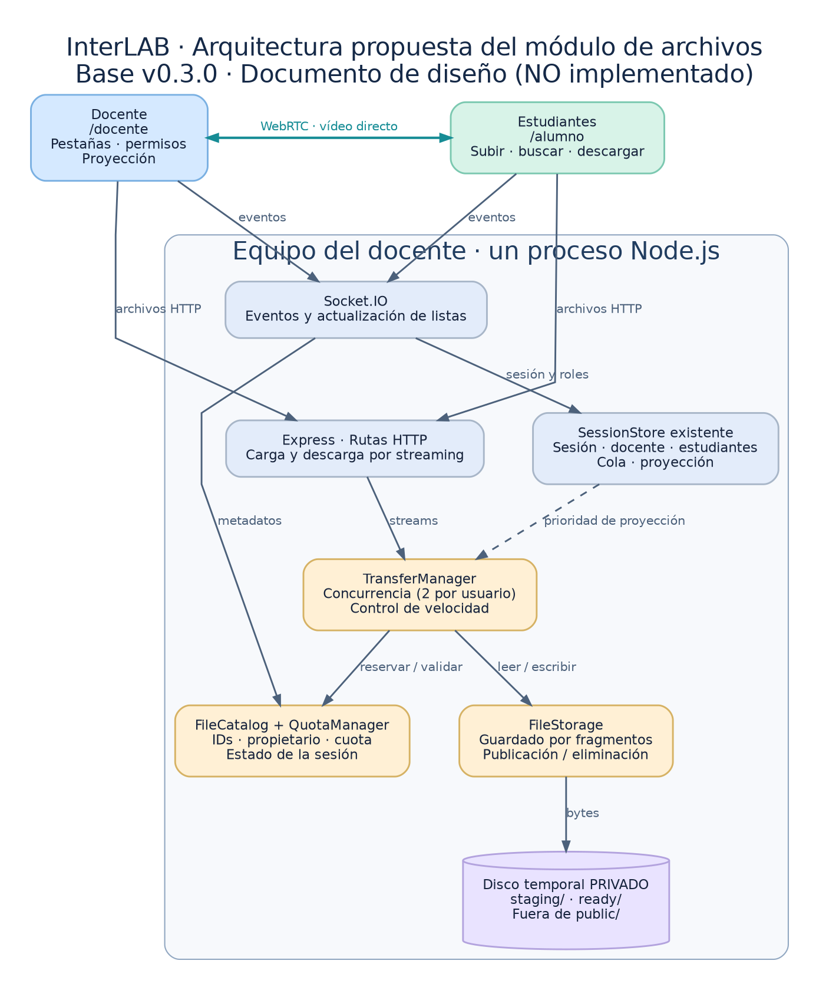
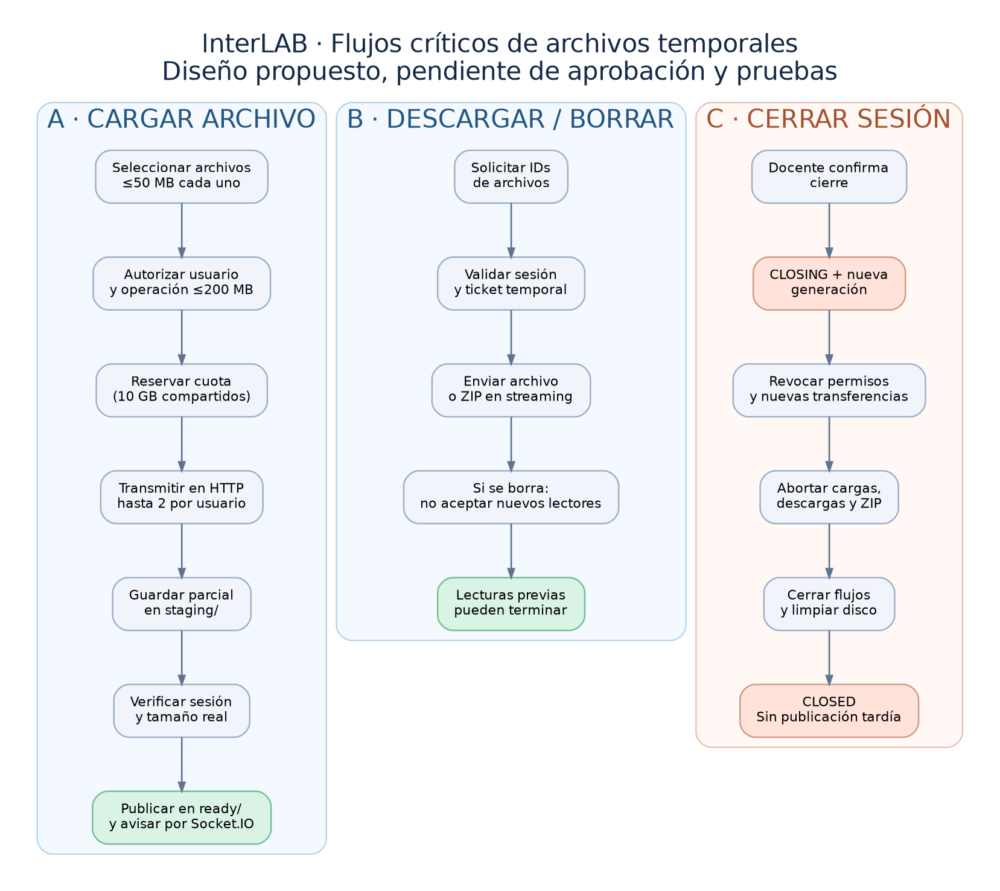

# Arquitectura implementada — módulo de archivos InterLAB v0.4.0 (beta)

**Base:** `PIIS(1).zip`, adoptado como InterLAB **v0.3.4**. **Incremento:** v0.4.0. **Fecha:** 28-10-2026. **Estado:** implementado en código con pruebas automatizadas; no validado con equipos Windows en LAN real.

## 1. Componentes

- `server.js`: rutas HTTP, credenciales de acceso, vínculo con Socket.IO y ciclo de sesión.
- `src/file-store.js`: metadatos en memoria, reservas de cuota, archivos temporales, streaming binario, ZIP de tipo *store*, eliminación y limitador de caudal.
- `src/session-store.js`: token temporal de archivos emitido al estudiante al ingresar y revocado al desconectarse; el docente utiliza el token temporal de sesión.
- `public/files.js`: pestañas por rol, selección, cola de carga, progreso, búsqueda, orden, descarga y eliminación.
- `public/app.js`: conserva la creación/cierre de sesión y la señalización WebRTC existente.

## 2. Identidad y permisos

El código de sesión **no autoriza** transferencias: solo permite incorporarse. El estudiante recibe un token aleatorio temporal tras ingresar, que se envía en `Authorization: Bearer …` en peticiones HTTP. El servidor comprueba token y rol en la sesión activa. El docente solo puede iniciar la sesión en el equipo anfitrión. Los nombres y alias no conceden permisos.

El docente ve «Mis archivos» y «Archivos de los alumnos», y puede eliminar cualquiera. Cada estudiante ve «Archivos del profesor», «Archivos de los alumnos» y «Mis archivos»; solo puede eliminar sus propios archivos. Todos los participantes pueden descargar archivos de la sesión. El propietario se identifica internamente por el ID de conexión, nunca por el alias.

## 3. Almacenamiento y cuotas

Los bytes se escriben fuera de `public/`, en un directorio privado bajo la carpeta temporal del sistema (`INTERLAB_FILES_DIR` permite elegir otra ubicación). Los metadatos, archivos publicados, reservas y tickets están en memoria. Un archivo solo aparece en el catálogo después de que la escritura termina y se renombra desde `.part`.

Límites **decimales**: **50 MB/archivo**, **200 MB/selección**, **10 GB/sesión**; como máximo **2 transferencias activas por participante**. La reserva de toda la selección evita carreras de cuota y se libera por archivo al completar o fallar. El servidor revisa también el espacio físico disponible; la interfaz no muestra cifras de capacidad. Una alerta de falta de espacio permanece visible para el docente hasta que se recupere capacidad suficiente.

El navegador realiza reintentos manuales desde cero. No hay cancelación normal de cargas, reanudación ni persistencia de catálogo. Tras desconexión, un alias reutilizado no recupera permisos sobre archivos anteriores.

## 4. API HTTP

| Método y ruta | Función | Autorización |
|---|---|---|
| `GET /api/files` | Lista metadatos, sin rutas físicas | token de sesión activo |
| `POST /api/files/batches` | Reserva cuota por una selección | token de sesión activo |
| `PUT /api/files/batches/:batch/:file` | Transmite cada archivo binario | mismo participante de la reserva |
| `DELETE /api/files/:id` | Elimina del catálogo | docente o propietario |
| `POST /api/files/tickets` | Emite ticket efímero para uno o varios archivos | token de sesión activo |
| `GET /api/files/download/:ticket` | Descarga individual o ZIP | ticket aleatorio, de un uso, 60 s |

Los tickets expiran y se consumen en un único GET; no se usa el token permanente de sesión como parámetro de URL. Los archivos tienen `Content-Disposition: attachment`, `Content-Type: application/octet-stream` y `X-Content-Type-Options: nosniff` para descargas individuales. La entrega ZIP se construye **por streaming sin compresión** y no se guarda completa en RAM/disco; se serializa con extensión ZIP64 cuando es necesario para offsets grandes. No hay límite adicional fijo en bytes de ZIP, solo protección de cantidad de elementos y recursos.

## 5. Notificaciones y prioridad de WebRTC

Socket.IO anuncia `files:changed` tras altas y bajas, y el cliente vuelve a obtener la lista mediante HTTP autenticado, conservando su búsqueda/orden. `files:capacity-alert` informa al docente del estado de capacidad. No se transmite el contenido binario en Socket.IO ni WebRTC.

Cuando hay un estudiante seleccionado con captura autorizada, el limitador común reduce el caudal de cargas y descargas, sin pausarlas. Valor provisional **1 MiB/s**, configurable con `INTERLAB_FILE_BPS_DURING_PROJECTION` (bytes por segundo). **No es un porcentaje fijado como requisito ni constituye una garantía de rendimiento**: hay que medir latencia y calidad de vídeo en el laboratorio para ajustarlo. El defecto A→B de la proyección continúa pendiente de prueba/corrección independiente.

## 6. Finalización de sesión

La interfaz pide confirmación antes de terminar. El servidor invalida sesión y tickets, interrumpe transferencias activas, evita publicar cargas tardías, espera su finalización y borra todos los binarios temporales de esa sesión. Las copias ya descargadas en dispositivos no pueden recuperarse ni eliminarse desde el servidor.

**Límites conocidos:** una terminación forzosa del sistema operativo o un corte eléctrico puede dejar archivos huérfanos en el temporal; no se restauran en memoria al reiniciar. Hace falta una política de eliminación de huérfanos controlada y pruebas de fallos severos. El cambio de presentador A→B requiere pruebas con navegador y LAN. Para no confundir validación estática con validación real, las pruebas de rendimiento y Firefox/Windows siguen pendientes.

## 7. Decisiones

[ADR-011 — Almacenamiento](decisiones/ADR-011-almacenamiento-temporal-y-catalogo.md), [ADR-012 — HTTP y ZIP](decisiones/ADR-012-transferencias-http-y-zip.md), [ADR-013 — Prioridad y cierre](decisiones/ADR-013-prioridad-proyeccion-y-cierre.md) y [ADR-014 — Certificados](decisiones/ADR-014-seleccion-generador-certificados.md).
